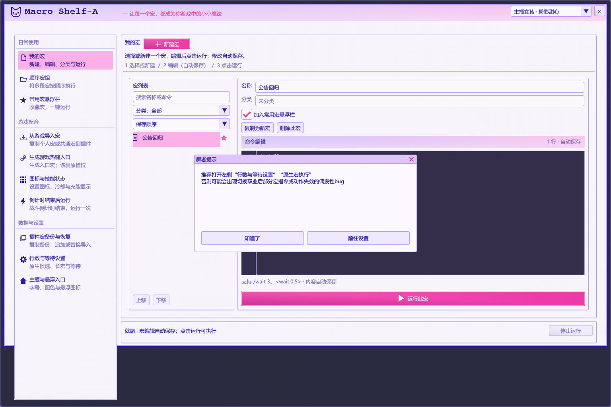
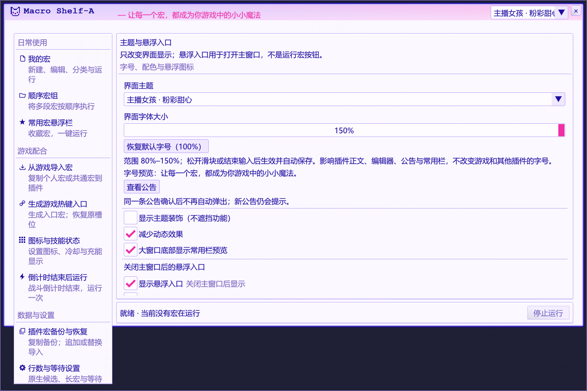
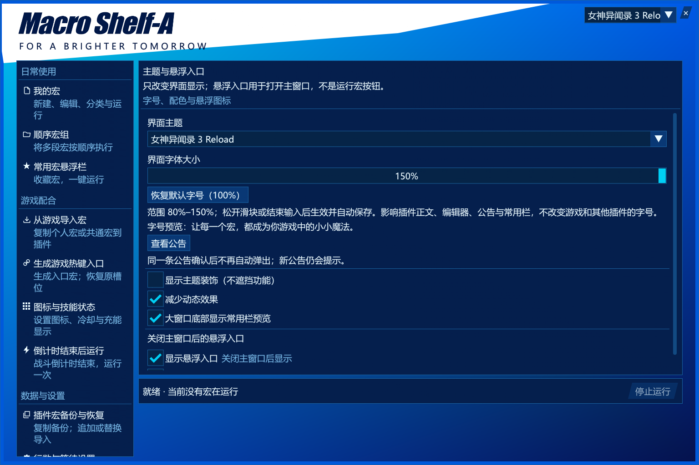
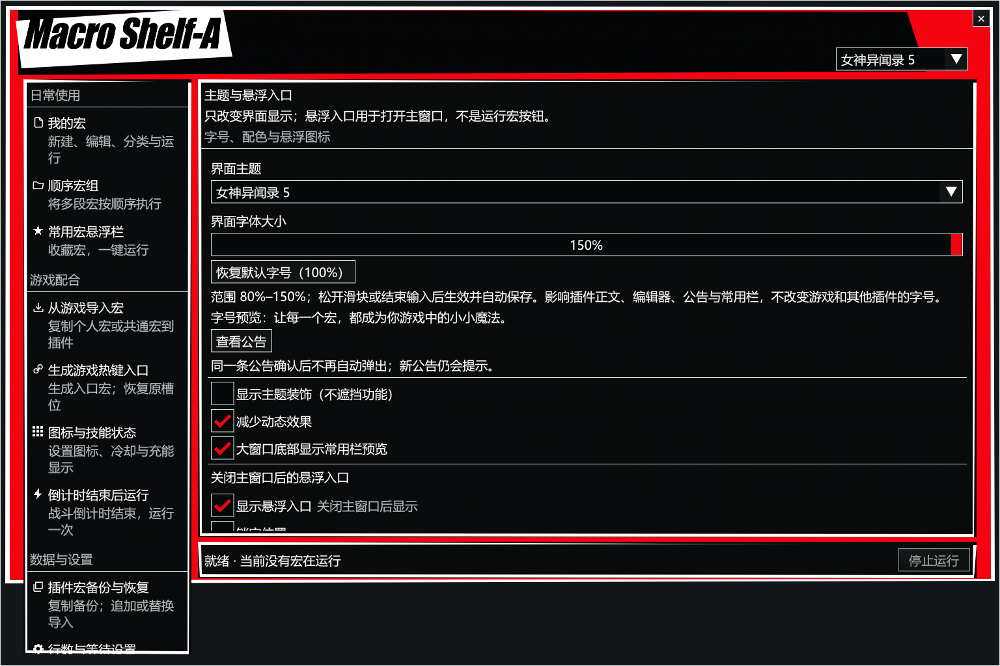

# Macro Shelf-A

当前在线版本 **0.9.6.16**。作者 **Akl**。DalamudCN API 15 / .NET 10。

插件简介：**当我受够了FF14那糟糕的宏指令**。

## 在线安装与更新

在 DalamudCN 的“自定义插件仓库”添加：

    https://raw.githubusercontent.com/Alittlerecallinglittlebrother/DalamudCN-Plugins/main/repo.json

保存后搜索 **Macro Shelf-A**。已添加仓库的玩家可刷新插件安装器后更新。若启用了同名本地开发版，先停用以免重复加载。更新后可用 `/aklmacro version` 确认实际版本 **0.9.6.16**。

[插件包](0.9.6.16/MacroShelfA.zip) · [发布说明](0.9.6.16/RELEASE.md) · [SHA256](0.9.6.16/SHA256SUMS.txt)

## 0.9.6.16 界面更新与弹窗修复

- 主界面和浮窗采用圆角布局，可在「外观与悬浮入口」选择语言、主题和字号。
- 按住浮窗按钮即可拖动。点击「常用宏」可打开或收起侧栏，打开主界面的按钮直接显示在浮窗上。
- 备份支持选择位置保存为 JSON 文件，也可从文件追加或替换宏库。
- 删除与替换确认框、公告和文件选择窗会随游戏窗口调整。主界面和浮窗使用同一套可滚动的常用宏选择器。

旧顺序宏组会在备份原配置后拆成独立宏。若游戏热键或倒计时绑定的是旧整组，请重新选择目标宏。

## 0.9.6.10 短间隔表情切换

- 不同表情可按小数间隔交替执行。
- 独立等待与行尾等待可混用，支持中英文和数字简写。

## 0.9.6.8 同一表情逐行重播

- 连续写同一个表情时，可以按小数间隔逐行重播。
- 修复在同一游戏进程内重载插件后，短间隔表情重播失效的问题。
- 编辑器标明等待支持 3 位小数，设置示例更新为 `/wait 0.125`、`/wait 120`、`<wait.0.125>`。

## 0.9.6.4 国服 7.58 兼容

更新原生宏执行、取消和动作诊断所用的客户端入口。

## 0.9.6.3 宏资料库与热键修复

- 写盘失败后可以重试追加、替换、新增、复制、移动或删除宏，原有条目、顺序和倒计时绑定得以保留。
- 修复旧热键运行错误条目的问题。若旧配置中的 ID 重复，请在“生成游戏热键入口”中重新选择目标并生成入口。
- 修复含表情的宏名称截断、升级时的配置备份、插件加载中断后的事件释放，以及等待设置与已保存值不一致的问题。

## 0.9.6.2 公告修复与自定义字号

- **公告清晰可读**：正文、标题和按钮跟随主题，修复主播女孩主题白字叠浅色背景。
- **同一公告不再重复弹出**：点击“知道了”“前往设置”或公告右上角 × 后保存已读状态，关闭重开与插件重载均保留。升级后首次需确认一次；只隐藏游戏 UI 或关闭整个主窗口不算确认。
- **可手动重看**：“主题与悬浮入口”中点击“查看公告”。以后仅公告内容版本更新时再次自动提示，不随普通插件版本升级重弹。
- **自定义字体大小**：“主题与悬浮入口”→“界面字体大小”，范围 **80%–150%**，默认 **100%**。可拖动滑块，或 Ctrl+点击输入；松开/结束输入后自动保存，可一键恢复默认。经典界面在“设置”中调整。
- 字号作用于插件正文、编辑器、公告和常用栏，**不改变游戏及其他插件字号**。主题贴图/品牌装饰不随字号重绘。字号和已读状态不会被宏备份追加/替换覆盖。

0.9.6.2 这次更新不改宏正文、原生执行选择、Runtime 源文件和游戏宏槽位。完整限制见 [发布说明](0.9.6.2/RELEASE.md)。

## 原生宏执行默认值

沿用 0.9.6.1：新配置和缺字段旧配置默认开启原生宏执行；**不会自动运行宏**。已有配置明确保存为关闭的，升级不会覆盖，包括此前版本自动保存的关闭值。如需切换，在「执行与等待」开启，或输入 `/aklmacro engine native`。`/aklmacro engine legacy` 手动关闭，`/aklmacro engine status` 查看模式。

v1–v4、缺少该字段的 v5 备份替换导入时默认开启；v5 明确保存的关闭选择继续保留。追加导入不改变当前执行设置。

原生宏执行适配国服 `2026.11.03.0000.0000` 客户端。长宏需开启“允许超过 15 行”，原生小数等待需开启“支持小数与长时间等待”。

## 第一次使用

1. `/aklmacro` 打开界面，在左侧选择 **我的宏**。
2. 点击 **新建宏**；已有游戏宏可在 **从游戏导入宏** 中预览并复制。
3. 选择宏，编辑名称、分类与命令；修改自动保存。
4. 点击 **运行此宏** 才启动。底部 **停止运行** 或 `/aklmacro stop` 可中止；选择、编辑和收藏不会运行宏。

## 界面功能

| 页面 | 操作与结果 |
|---|---|
| 我的宏 | 新建、选择、搜索、分类、编辑、复制、删除确认、收藏与手动运行。 |
| 常用宏栏 | 添加、运行、编辑或移出收藏，并设置游戏浮窗入口和侧栏宽度。 |
| 从游戏导入宏 | 预览个人 / 共通各 100 槽，将选择的宏复制为插件内独立条目；不修改来源、不自动运行。 |
| 游戏热键入口 | 选择宏，预览槽位，备份并写入一行入口，或恢复原槽。生成后在游戏宏窗口手动拖到热键栏。 |
| 图标与技能状态 | 选择作用对象与普通 PvE 技能，预览图标、冷却和充能；明确保存或放弃。显示状态不代表整段宏一定可执行。 |
| 战斗倒计时 | 绑定一个宏。启用后在游戏战斗倒计时完成时运行一次。 |
| 备份与恢复 | 导出 JSON 文件，或选择文件后追加宏。替换现有宏库需要确认。 |
| 执行与等待 | 选择原生或旧执行器，设置长宏和小数等待，直接查看短间隔表情示例。 |
| 外观与悬浮入口 | 切换简体中文或 English，调整浅色、深色或跟随系统的主题、字号和浮窗。 |

## 界面与兼容性

主界面、编辑器和常用宏使用原生字号绘制。字号调大后可滚动侧栏、正文和选择器列表。

已有的唯一宏 ID 会保留；缺失或重复的 ID 会在启动时修复并保存。旧逐行模式仍保留数字切职顺序保护；原生模式交由游戏运行原始命令与等待，不插入该逐行闸门。配置版本仍为 **9**、交换格式 **5**；JSON 克隆 / 恢复创建新 ID 后需要重新生成关联游戏入口。

- `/aklmacro`：打开主界面
- `/aklmacro bar`：常用宏悬浮栏
- `/aklmacro stop`：停止运行
- `/aklmacro version`：查看实际加载版本
- `/aklmacro trace on / trace status / trace off`：可选动作诊断，默认关闭

## 0.9.6.2 历史预览

以下来自 0.9.6.2 生产 C# / 原生 ImGui 离线宿主，**不是游戏截图或生图**。游戏状态、纹理与字体句柄准备时序由测试夹具代替，文字由真实中文字体栅格化。

### 主播女孩：公告配色修复

### 主播女孩：150% 字号设置

### P3：150% 字号设置

### P5：150% 字号设置

## 验证与发行说明

0.9.6.16 通过 404 项逻辑与接口检查、3,894 项主界面离线 ImGui 检查及 Harness² 复核。维护者在游戏内复测本次弹窗修复，确认弹窗没有再溢出。[验证记录](0.9.6.16/VERIFICATION.json)

0.9.6.10 通过 403 项项目回归。国服 7.58 实测了原生和旧版执行器，76 组宏的 394 条动作指令均按顺序执行。[验证记录](0.9.6.10/VERIFICATION.json)

安装包、发布说明、验证记录和校验值可在版本目录查看。

历史在线版本 [0.9.6.10](0.9.6.10/)、[0.9.6.8](0.9.6.8/)、[0.9.6.4](0.9.6.4/)、[0.9.6.3](0.9.6.3/)、[0.9.6.2](0.9.6.2/)、[0.9.6.1](0.9.6.1/)、[0.9.6.0](0.9.6.0/)、[0.9.5.2](0.9.5.2/)、[0.9.5.1](0.9.5.1/)、[0.9.4.0](0.9.4.0/)、[0.8.4.0](0.8.4.0/)、[0.8.2.0](0.8.2.0/)、[0.6.1.0](0.6.1.0/)、[0.5.0.0](0.5.0.0/) 与 [0.4.1.0](0.4.1.0/)。
