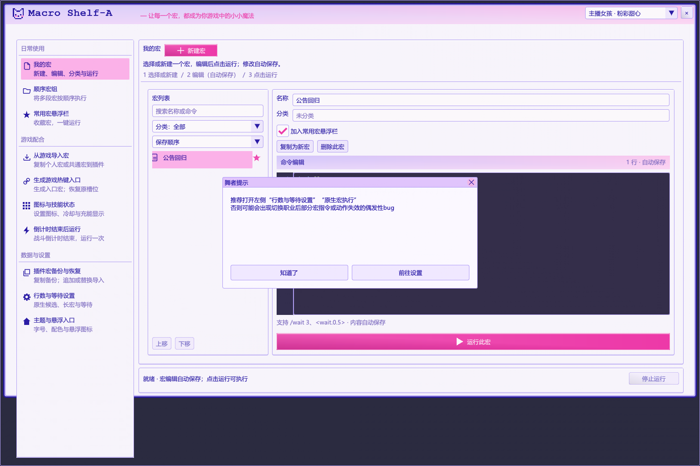
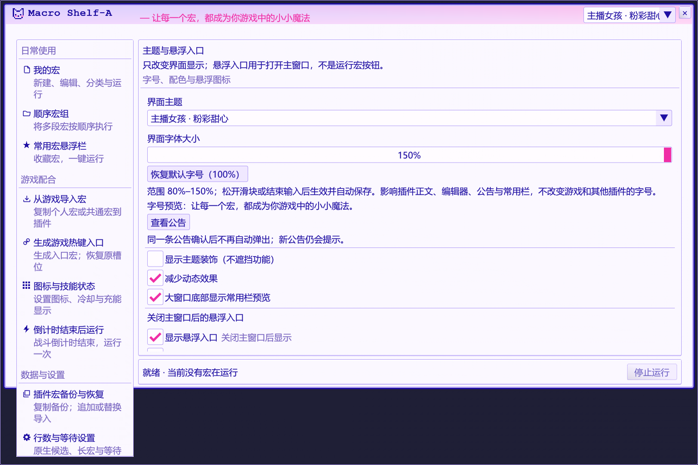
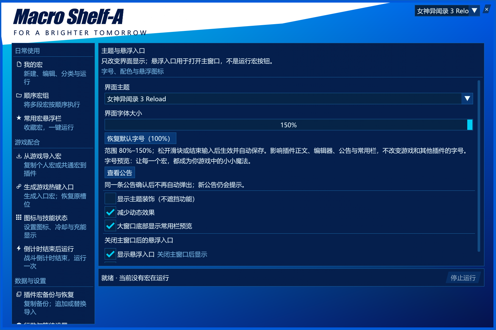
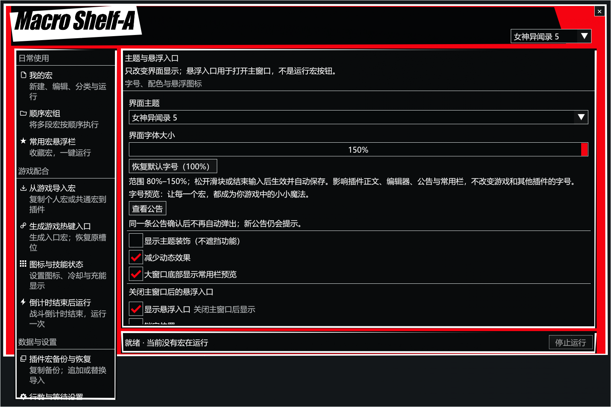

# Macro Shelf-A

当前在线版本：**0.9.6.2**。作者：**Akl**。DalamudCN API 15 / .NET 10。

插件简介：**当我受够了FF14那糟糕的宏指令**。

## 在线安装与更新

在 DalamudCN 的“自定义插件仓库”添加：

    https://raw.githubusercontent.com/Alittlerecallinglittlebrother/DalamudCN-Plugins/main/repo.json

保存后搜索 **Macro Shelf-A**；已添加者刷新插件安装器后更新。若启用了同名本地开发版，先停用以免重复加载。建议退出游戏后更新，再用 `/aklmacro version` 确认实际版本 **0.9.6.2**。

[插件包](0.9.6.2/MacroShelfA.zip) · [对应源码与测试](0.9.6.2/MacroShelfA-source.zip) · [发布说明](0.9.6.2/RELEASE.md) · [SHA256](0.9.6.2/SHA256SUMS.txt)

## 0.9.6.2 公告修复与自定义字号

- **公告清晰可读**：正文、标题和按钮跟随主题，修复主播女孩主题白字叠浅色背景。
- **同一公告不再重复弹出**：点击“知道了”“前往设置”或公告右上角 × 后保存已读状态，关闭重开与插件重载均保留。升级后首次需确认一次；只隐藏游戏 UI 或关闭整个主窗口不算确认。
- **可手动重看**：“主题与悬浮入口”中点击“查看公告”。以后仅公告内容版本更新时再次自动提示，不随普通插件版本升级重弹。
- **自定义字体大小**：“主题与悬浮入口”→“界面字体大小”，范围 **80%–150%**，默认 **100%**。可拖动滑块，或 Ctrl+点击输入；松开/结束输入后自动保存，可一键恢复默认。经典界面在“设置”中调整。
- 字号作用于插件正文、编辑器、公告和常用栏，**不改变游戏及其他插件字号**。主题贴图/品牌装饰不随字号重绘。字号和已读状态不会被宏备份追加/替换覆盖。

本次不改宏正文、原生执行选择、Runtime 源文件和游戏宏槽位。完整限制见 [发布说明](0.9.6.2/RELEASE.md)。

## 原生宏执行默认值

沿用 0.9.6.1：新配置和缺字段旧配置默认开启原生宏执行；**不会自动运行宏**。已有配置明确保存为关闭的，升级不会覆盖，包括此前版本自动保存的关闭值。如需切换，在“行数与等待设置”开启一次，或输入 `/aklmacro engine native`。`/aklmacro engine legacy` 手动关闭，`/aklmacro engine status` 查看模式。

v1–v4、缺少该字段的 v5 备份替换导入时默认开启；v5 明确保存的关闭选择继续保留。追加导入不改变当前执行设置。

保留国服 `2026.10.06.0000.0000` 客户端适配、精确身份/SDK 布局/取消 ABI/归属和等待队列保护；不匹配时拒绝运行且不自动回退。长宏需开启“允许超过 15 行”，小数等待需对应补丁成功启用。

## 第一次使用

1. `/aklmacro` 打开界面，在左侧选择 **我的宏**。
2. 点击 **新建宏**；已有游戏宏可在 **从游戏导入宏** 中预览并复制。
3. 选择宏，编辑名称、分类与命令；修改自动保存。
4. 点击 **运行此宏** 才启动。底部 **停止运行** 或 `/aklmacro stop` 可中止；选择、编辑和收藏不会运行宏。

## 所有功能直接列出

P3、主播女孩、P5 三主题共用以下十个独立页面。经典界面的原资料库与编辑台仍保留为兼容回退。

| 页面 | 操作与结果 |
|---|---|
| 我的宏 | 新建、选择、搜索、分类、编辑、复制、删除确认、收藏与手动运行。 |
| 顺序宏组 | 新建组、添加与排序子宏；明确选择只运行此子宏或运行所属宏组。 |
| 常用宏悬浮栏 | 添加、运行、编辑或移出收藏，设置显示、锁定、列数与宽度；移出不删除宏。 |
| 从游戏导入宏 | 预览个人 / 共通各 100 槽，将选择的宏复制为插件内独立条目；不修改来源、不自动运行。 |
| 生成游戏热键入口 | 选择宏 / 组 / 子宏，预览槽位，备份并写入一行入口，或恢复原槽。生成后在游戏宏窗口手动拖到热键栏。 |
| 图标与技能状态 | 选择作用对象与普通 PvE 技能，预览图标、冷却和充能；明确保存或放弃。显示状态不代表整段宏一定可执行。 |
| 倒计时结束后运行 | 绑定宏或宏组，主动启用 / 停用；真实战斗倒计时完成时触发一次，忙碌时不排队。 |
| 插件宏备份与恢复 | 复制或粘贴 JSON，追加保留现有宏，替换需要确认；与游戏宏槽位恢复分开。 |
| 行数与等待设置 | 选择原生/旧执行器、允许超过 15 行、设置小数或长等待，查看状态说明。 |
| 主题与悬浮入口 | 自定义字号、查看公告、切换主题、装饰、减少动效、底部常用栏，以及关闭主窗口后的悬浮入口。 |

## 界面与兼容性

保留 P3 蓝青水光、主播女孩粉紫复古、P5 红黑白剪纸及原有动效。人物只做左侧小装饰。功能文字使用原生常规字体，不叠画加粗、不人工斜体。字号调大后可滚动侧栏与正文访问更多内容。

保留旧宏 ID、正文、顺序、收藏、长宏及倒计时逻辑。旧逐行模式仍保留数字切职顺序保护；原生模式交由游戏运行原始命令与等待，不插入该逐行闸门。配置版本仍为 **9**、交换格式 **5**；JSON 克隆 / 恢复创建新 ID 后需要重新生成关联游戏入口。

- `/aklmacro`：打开主界面
- `/aklmacro bar`：常用宏悬浮栏
- `/aklmacro stop`：停止运行
- `/aklmacro version`：查看实际加载版本
- `/aklmacro trace on / trace status / trace off`：可选动作诊断，默认关闭

## 实际控件离线预览

以下来自 0.9.6.2 生产 C# / 原生 ImGui 离线宿主，**不是游戏截图或生图**。游戏状态、纹理与字体句柄准备时序由测试夹具代替，文字由真实中文字体栅格化。

### 主播女孩：公告配色修复

### 主播女孩：150% 字号设置

### P3：150% 字号设置

### P5：150% 字号设置

## 验证与发行说明

**Debug / Release 构建均为 0 警告、0 错误；376 项逻辑/ABI 测试、4829 条原生 ImGui UI 断言通过，其中公告 1385、字号 850。** 安装 ZIP 的 DLL 与已构建 Release 产物逐字节一致；原有 23 个 Runtime 源文件未变。

**尚未完成本版本游戏内验证。** 离线测试不等于实际 Dalamud 字体异步构建、中文字体回退、宏动作、外部接管或取消均已通过；较早客户端的录像也不能替代本版本验收。

安装 ZIP 不包含 SDK、测试夹具和调试符号；对应源码、发行说明、验证摘要与校验值一并提供。

历史在线版本 [0.9.6.1](0.9.6.1/)、[0.9.6.0](0.9.6.0/)、[0.9.5.2](0.9.5.2/)、[0.9.5.1](0.9.5.1/)、[0.9.4.0](0.9.4.0/)、[0.8.4.0](0.8.4.0/)、[0.8.2.0](0.8.2.0/)、[0.6.1.0](0.6.1.0/)、[0.5.0.0](0.5.0.0/) 与 [0.4.1.0](0.4.1.0/) 保留不变。
